# End-to-End System Architecture: PlumeTrace Digital Twin

Complete architectural blueprint and data flow topology connecting the physical lab arena, desktop edge/twin stack (ROS 2 Jazzy & Gazebo Harmonic), the PlumeTrace City View web dashboard, and Bavarian geospatial open data services.

---

## 1. Complete System Architecture Diagram

```mermaid
flowchart TB
  classDef hw fill:#fdecea,stroke:#a32a1d,color:#3d0f0a;
  classDef ros fill:#e8f1fb,stroke:#1d4f91,color:#10243f;
  classDef sim fill:#e9f7f4,stroke:#17695a,color:#0b2e28;
  classDef ext fill:#eef5ea,stroke:#2b6a2b,color:#143014;
  classDef store fill:#f3eefa,stroke:#5b3a8c,color:#24123f;
  classDef ui fill:#fff7e6,stroke:#b26a00,color:#3d2600;
  classDef cesium fill:#e6f6ff,stroke:#0b6fa4,color:#06324a;
  classDef opt fill:#ffffff,stroke:#777777,color:#333333,stroke-dasharray: 6 4;

  %% ================= physical lab =================
  subgraph ARENA["Lab arena"]
    direction TB
    subgraph TB3["TurtleBot3 Burger (ROS 2 Jazzy, reached by ssh)"]
      BRINGUP["turtlebot3_bringup<br/>robot.launch.py"]:::hw
      LDS["LiDAR"]:::hw
      BASE["OpenCR + wheels<br/>odometry, IMU, battery"]:::hw
    end
    CAM["Fixed overhead camera"]:::hw
  end

  %% ================= lab desktop: ROS =================
  subgraph DESK["Lab desktop (ROS 2 Jazzy, same ROS domain as the robot)"]
    direction TB

    subgraph NAVG["Navigation"]
      AMCL["AMCL + map_server<br/>arena map"]:::ros
      NAV["Nav2 planner, controller,<br/>behaviours"]:::ros
      KEEP["Keepout filter<br/>river = no-drive area"]:::ros
      CMON["Collision monitor"]:::ros
    end

    subgraph EDGEG["Robot-side logic"]
      SENS["emulated_sensor<br/>NH3-N and DO at the probe"]:::ros
      EDGE["edge_buffer<br/>store and resend"]:::ros
      DET["obstacle_detector<br/>LiDAR clusters"]:::ros
      LINK{{"link_gate<br/>models link loss"}}:::ros
    end

    subgraph TWING["Digital twin"]
      ING["sample_ingest"]:::ros
      CORE["twin_core<br/>plume model, source estimator,<br/>next sampling point"]:::ros
      MC["mission_controller<br/>mission state machine"]:::ros
      SYNC["sync_monitor"]:::ros
      REG["obstacle_registry"]:::ros
      VOC["virtual_obstacle_cloud"]:::ros
      LOG["run_logger + rosbag"]:::ros
    end

    subgraph GZG["Gazebo Harmonic (mirror of the arena)"]
      GZ["gz sim<br/>arena, water, ghost robot,<br/>obstacle boxes"]:::sim
      BRIDGE["ros_gz_bridge"]:::sim
      GHOST["ghost_follower"]:::sim
      SPAWN["obstacle spawner"]:::sim
    end

    GW["gateway node<br/>ROS topics to JSON<br/>arena to river to lat/lon<br/>WebSocket :8765"]:::ui

    subgraph FILES["Files on the desktop"]
      MAPS[("arena map, keepout masks,<br/>Gazebo world")]:::store
      FRAME[("reach_frame.yaml<br/>arena to river to WGS84")]:::store
      SCEN[("scenarios A, B, C")]:::store
      GEO[("web/data GeoJSON<br/>water, outfalls, stations")]:::store
      RUNS[("student_ws/src<br/>logs, rosbags, videos")]:::store
    end
    HTTP["Static web server<br/>:8080"]:::ui
    CHEESE["Cheese<br/>camera recording"]:::ui
  end

  %% ================= dashboard in the browser =================
  subgraph DASH["Dashboard: PlumeTrace City View (browser)"]
    direction TB

    subgraph GLOBE["CesiumJS 3D globe at the Pegnitz, Nürnberg"]
      direction TB
      TERR["Terrain<br/>Cesium World Terrain"]:::cesium
      IMG["Base map<br/>OpenStreetMap imagery"]:::cesium
      BLDG["3D buildings<br/>Cesium OSM Buildings"]:::cesium
      TILES["3D Tiles<br/>WaterBody + LoD2 buildings"]:::opt
      LWATER["Water polygon"]:::cesium
      LOUT["Outfalls A, B, C<br/>gauge, chemistry station"]:::cesium
      LROBOT["Robot icon + track"]:::cesium
      LPLUME["Plume points<br/>coloured by NH3-N"]:::cesium
      LSAMP["Sample markers"]:::cesium
      LOBS["Obstacles + no-go zones<br/>real, REROUTE, STOP"]:::cesium
    end

    subgraph PANELS["Side panels"]
      direction TB
      PHEAD["Header<br/>mode, state, sync, time factor, link"]:::ui
      PMISS["Mission<br/>samples, scenario, battery"]:::ui
      PSYNC["Sync per stream<br/>link, pose, samples"]:::ui
      PPOST["Which outfall?<br/>probability bars A, B, C, strength"]:::ui
      PALERT["Alerts<br/>NH3-N above 0.6 mg/L"]:::ui
      PCMD["Commands<br/>abort, return home,<br/>draw no-go zone,<br/>place obstacle, remove"]:::ui
      PTIME["Timeline + replay<br/>export samples CSV"]:::ui
    end

    WSC["WebSocket client<br/>schema-checked JSON"]:::ui
  end

  %% ================= external services =================
  subgraph CLOUD["Outside services"]
    ION["Cesium ion<br/>terrain + building tiles<br/>needs the ion token"]:::ext
    OSMT["OpenStreetMap<br/>tile server"]:::ext
    CDB[("3DCityDB<br/>CityGML WaterBody + LoD2")]:::opt
    FME["FME<br/>CityGML, 3D Tiles, meshes"]:::opt
  end
  subgraph DATA["Open data (Bavaria)"]
    GIS["ALKIS river polygon,<br/>DGM1 terrain, LoD2 buildings"]:::ext
    GKD["GKD gauge and chemistry<br/>discharge, NH4-N, oxygen"]:::ext
  end
  TRUTH["Camera-based<br/>ground-truth pose"]:::opt

  %% ---------- robot <-> desktop ----------
  LDS --> BRINGUP
  BASE --> BRINGUP
  BRINGUP -- "scan" --> AMCL
  BRINGUP -- "scan" --> DET
  BRINGUP -- "scan" --> CMON
  BRINGUP -- "odom, tf" --> AMCL
  BRINGUP -- "battery state" --> GW
  CMON -- "cmd_vel" --> BRINGUP

  %% ---------- navigation ----------
  MAPS --> AMCL
  MAPS --> KEEP
  AMCL -- "robot pose" --> NAV
  KEEP --> NAV
  NAV -- "cmd_vel_raw" --> CMON

  %% ---------- sensing and link ----------
  AMCL -- "robot pose" --> SENS
  SCEN --> SENS
  FRAME --> SENS
  SENS -- "PlumeSample" --> EDGE
  EDGE -- "samples, pose, heartbeat" --> LINK
  LINK -- "ack" --> EDGE
  LINK --> ING
  LINK --> SYNC

  %% ---------- twin ----------
  ING -- "twin/samples" --> CORE
  ING --> MC
  SCEN --> CORE
  FRAME --> CORE
  CORE -- "next goal, posterior" --> MC
  MC -- "NavigateToPose" --> NAV
  MC -- "sensor trigger" --> SENS
  SYNC -- "SyncStatus" --> MC

  %% ---------- obstacles ----------
  DET -- "detections" --> REG
  REG -- "twin/obstacles" --> VOC
  VOC -- "REROUTE cloud" --> NAV
  VOC -- "STOP cloud" --> CMON
  REG --> SPAWN

  %% ---------- Gazebo mirror ----------
  MAPS --> GZ
  AMCL -- "robot pose" --> GHOST
  GHOST --> BRIDGE
  SPAWN --> BRIDGE
  BRIDGE <--> GZ
  GHOST -- "ghost pose beat" --> SYNC

  %% ---------- ROS -> gateway ----------
  AMCL -- "robot pose" --> GW
  CORE -- "plume points, posterior" --> GW
  ING -- "samples" --> GW
  MC -- "mission state" --> GW
  SYNC -- "sync status" --> GW
  REG -- "obstacles" --> GW
  FRAME --> GW

  %% ---------- gateway <-> dashboard ----------
  GW <-- "ws://localhost:8765" --> WSC
  HTTP -- "index.html, config, schema" --> DASH
  GEO --> HTTP

  %% ---------- messages into the globe ----------
  WSC -- "pose" --> LROBOT
  WSC -- "plume_points" --> LPLUME
  WSC -- "sample" --> LSAMP
  WSC -- "obstacles" --> LOBS
  HTTP -- "GeoJSON" --> LWATER
  HTTP -- "GeoJSON" --> LOUT

  %% ---------- messages into the panels ----------
  WSC -- "hello, mission" --> PHEAD
  WSC -- "mission" --> PMISS
  WSC -- "sync" --> PSYNC
  WSC -- "posterior" --> PPOST
  WSC -- "sample, alert" --> PALERT
  WSC -- "all, time-stamped" --> PTIME

  %% ---------- commands back ----------
  PCMD -- "abort, home, add or remove<br/>no-go and obstacles" --> WSC
  LOBS -. "map click gives lat/lon" .-> PCMD
  GW -- "twin/command" --> MC
  GW -- "twin/registry_cmd" --> REG

  %% ---------- Cesium outside data ----------
  ION -- "terrain tiles" --> TERR
  ION -- "building tiles" --> BLDG
  OSMT -- "map tiles" --> IMG
  TERR -. "ground height at the reach" .-> LWATER

  %% ---------- GIS pipeline ----------
  GIS -- "reach build" --> MAPS
  GIS --> FRAME
  GIS --> GEO
  GKD -- "scenario update" --> SCEN
  GIS -.-> FME
  FME -.-> CDB
  FME -. "tileset.json" .-> TILES

  %% ---------- camera, logs, replay ----------
  CAM -- "video" --> CHEESE
  CHEESE --> RUNS
  CAM -.-> TRUTH
  TRUTH -. "check AMCL pose" .-> SYNC
  ING --> LOG
  CORE --> LOG
  MC --> LOG
  LOG --> RUNS
  RUNS -- "replay file" --> PTIME
```



---

## 2. Architectural Subsystem Breakdown

### 1. Lab Arena (Physical Domain)
- **TurtleBot3 Burger**: Operating on **ROS 2 Jazzy**, accessed over secure shell (`ssh`).
  - `turtlebot3_bringup/robot.launch.py`: Hardware bring-up node.
  - `LiDAR (LDS-02)`: Broadcasts 360° distance scans (`/scan`).
  - `OpenCR + Wheels`: Motor control, wheel encoders (`/odom`), IMU, and battery state reporting.
- **Fixed Overhead Camera**:
  - Streams live video to desktop recording tool (`Cheese`).
  - Feeds an optical tracking module (`Camera-based ground-truth pose`) to independently measure physical position and benchmark AMCL estimation accuracy.

### 2. Lab Desktop Core (Edge, Twin & Simulation)
Operating on **ROS 2 Jazzy** sharing the same ROS Domain ID (`ROS_DOMAIN_ID`) with the robot.

#### A. Navigation Subsystem (`NAVG`)
- `AMCL + map_server`: Global localization using 2D occupancy grid arena maps.
- `Nav2`: Path planning (`planner_server`), trajectory tracking (`controller_server`), and recovery behaviors.
- `Keepout filter`: Enforces safety masks (e.g., river exclusion boundary = no-drive zone).
- `Collision monitor`: Intercepts `cmd_vel_raw` from Nav2, receives `STOP cloud` from virtual obstacle safety pipeline, and dispatches verified `cmd_vel` to hardware.

#### B. Robot-Side & Sensing Logic (`EDGEG`)
- `emulated_sensor`: Reads AMCL pose, `scenarios A, B, C`, and `reach_frame.yaml` to emit synthetic $\text{NH}_3\text{-N}$ and $\text{DO}$ readings (`PlumeSample`).
- `edge_buffer`: Stores telemetry packets locally and guarantees reliable transmission to twin.
- `obstacle_detector`: Segments real-time LiDAR point clusters to detect physical hurdles in the arena.
- `link_gate`: Hardware/software-in-the-loop bridge modeling packet loss and latency; transmits acknowledged samples to ingestion and synchronization monitors.

#### C. Digital Twin Subsystem (`TWING`)
- `sample_ingest`: Ingestion buffer for verified water quality observations.
- `twin_core`: Core analytical engine executing the 2D advection-diffusion dispersion model, probabilistic source estimation across candidates (A, B, C), and optimal next sampling point determination.
- `mission_controller`: Master state machine orchestrating navigation goals (`NavigateToPose`), sensor sampling triggers, and fail-safe transitions.
- `sync_monitor`: Monitors state drift across physical odometry, AMCL pose, Gazebo ghost follower, and camera ground-truth.
- `obstacle_registry`: Centralized register of real detected hurdles and user-injected virtual obstacles.
- `virtual_obstacle_cloud`: Translates obstacle definitions into real-time point clouds:
  - `REROUTE cloud`: Dynamically updates Nav2 costmaps.
  - `STOP cloud`: Triggers immediate emergency halt in Collision Monitor.
- `run_logger + rosbag`: Full telemetry capture to `student_ws/src` for post-run analysis.

#### D. Gazebo Harmonic Mirror (`GZG`)
- `gz sim`: Synchronized virtual replica of arena, water boundaries, obstacle boxes, and a **ghost robot**.
- `ros_gz_bridge`: Bidirectional ROS 2 $\leftrightarrow$ Gazebo message translation.
- `ghost_follower`: Mirrors the physical robot's AMCL pose in simulation and emits heartbeat beats to `sync_monitor`.
- `obstacle spawner`: Spawns physical or virtual obstacle boxes in the simulation world.

#### E. Gateway & Networking
- `gateway node`: Translates ROS 2 topics into schema-validated JSON, handles coordinate transformations between Arena $(x, y)$, River Reach coordinate systems, and WGS84 (Lat/Lon), serving WebSocket stream on port `:8765`.
- `Static HTTP Server`: Serves web dashboard frontend and GeoJSON vector assets on port `:8080`.

---

## 3. PlumeTrace City View Dashboard (Browser UI)

Interactive WebGL dashboard running in the browser, featuring CesiumJS with live telemetry and bilateral mission controls:

### CesiumJS 3D Globe (Pegnitz Reach, Nuremberg)
- **Terrain & Elevation**: Cesium World Terrain via Cesium ion token.
- **Basemap Imagery**: OpenStreetMap (OSM) tile server.
- **3D Buildings & Infrastructure**: Cesium OSM Buildings and Bavarian LOD2 CityGML / 3D Tiles via 3DCityDB & FME.
- **Operational Overlays**:
  - Pegnitz Water Polygon (`LWATER`).
  - Candidate Outfalls A, B, C, stream gauge, and chemistry stations (`LOUT`).
  - Real-time Robot Icon & trajectory trail (`LROBOT`).
  - Chemical Plume Point Cloud color-coded by $\text{NH}_3\text{-N}$ concentration (`LPLUME`).
  - Interactive Sample Markers (`LSAMP`).
  - Real and virtual obstacles + no-go exclusion zones (`LOBS`).

### Telemetry & Control Side Panels
1. **Header Panel**: Operational mode, system state machine, synchronization status, time acceleration factor, and link health.
2. **Mission Panel**: Sample tally, active scenario, battery charge state.
3. **Sync per Stream**: Latency and drift tracking for link, pose, and sample channels.
4. **Posterior Probability Panel ("Which outfall?")**: Real-time probability convergence bars for Candidates A, B, and C, with estimated discharge strength.
5. **Alerts Panel**: Statutory compliance monitoring with instantaneous alerts when $\text{NH}_3\text{-N} > 0.6\ \text{mg/L}$.
6. **Commands Panel (Bidirectional DTAS)**: Dispatch manual abort, return home, draw custom no-go zones, place/remove virtual obstacles on the live map.
7. **Timeline & Replay**: Historical mission scrubber, timeline playback, and CSV sample export.

---

## 4. Coordinate Transformation Pipeline (`reach_frame.yaml`)

```text
[Arena Frame (m)]             [River Reach Frame (m)]              [WGS84 Frame (deg)]
(X_arena, Y_arena)    <--->   (X_river, Y_river, Z_river)  <--->   (Latitude, Longitude)
Lab Floor Coordinates         Pegnitz Reach Coordinates            Global Coordinates on Cesium
```
- Handled transparently by the `gateway node` to ensure that physical robot motion in the lab arena maps accurately to the Bavarian Pegnitz riverbank in Nuremberg on the 3D Cesium globe.
