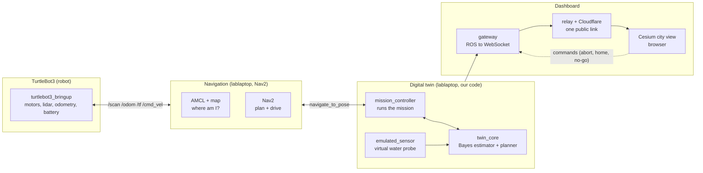
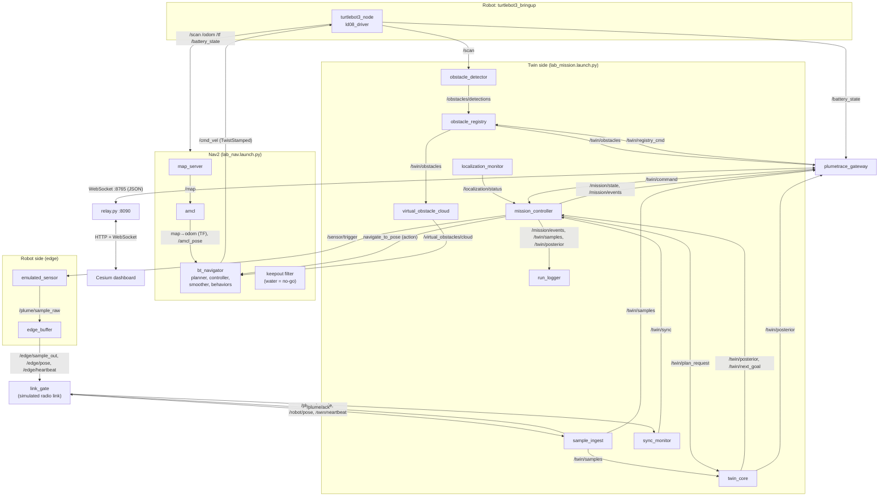
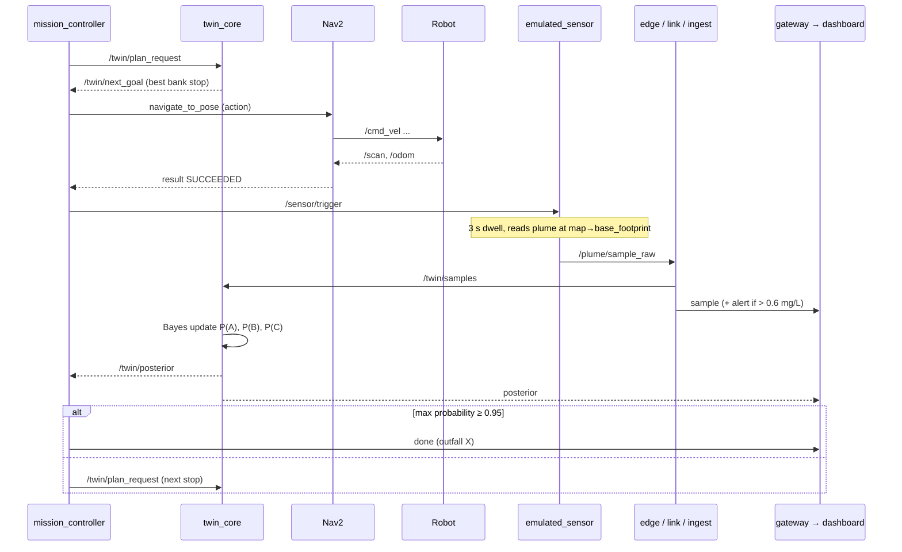
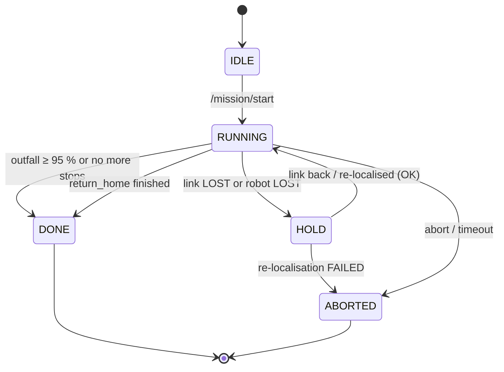
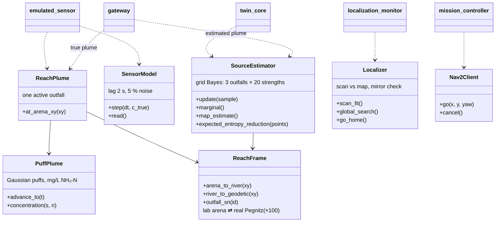
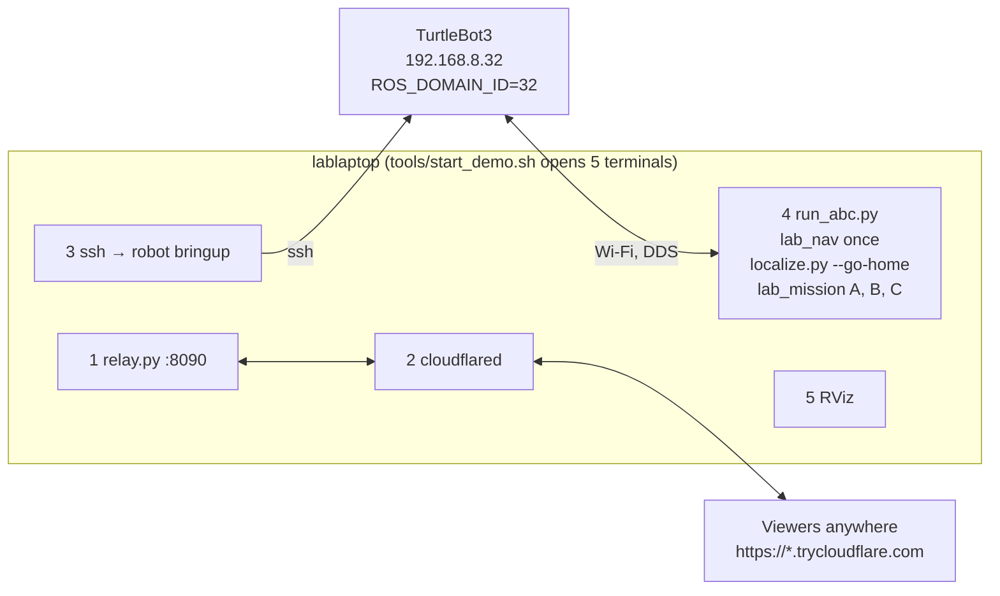

# PlumeTrace: how the system works (for presenting)

## 1. The idea in one paragraph

A pollutant (ammonium, NH₃-N) leaks from one of three outfalls (A, B, C) into a river. We build a
**1:100 model** of 300 m of the **Pegnitz in Nürnberg** on the lab floor (3 m of taped river). A
**TurtleBot3** drives along the bank, stops, "samples" the water, and a **digital twin** on the laptop
updates the probability for each outfall after every sample and decides where to sample next. When one
outfall reaches **95 %**, the mission ends. A **Cesium 3D city dashboard** shows the robot on the real
river in Nürnberg, the plume, the readings, and an incident workflow (alerts, who to call, public warning).

The water probe is **emulated**: the robot's real position is used to read a simulated plume. Everything
else (driving, mapping, localisation, obstacle detection) is real.

## 2. The four layers

| Layer | Runs on | What it does | Our code? |
| --- | --- | --- | --- |
| Robot | TurtleBot3 | Motors, lidar (`/scan`), wheel odometry (`/odom`), battery | No (ROBOTIS stock) |
| Navigation | lablaptop | Map, AMCL localisation, path planning, driving (`/cmd_vel`) | Config + launch files |
| Digital twin | lablaptop | Mission logic, virtual probe, estimator, planner, obstacles, localisation check | Yes (`plumetrace_twin`) |
| Dashboard | lablaptop + browser | Gateway, relay, Cesium page | Yes (`plumetrace_gateway`, `tools/relay.py`, `web/`) |

## 3. ROS 2 in 30 seconds (for the audience)

- **Node** = one small program (e.g. `mission_controller`).
- **Topic** = a named channel; nodes **publish** and **subscribe** (e.g. `/scan` = laser data, many readers).
- **Service** = request → reply, once (e.g. "reset localisation").
- **Action** = long task with progress and a result (e.g. `navigate_to_pose`: "drive there, tell me when done").
- **TF** = the tree of coordinate frames (`map → odom → base_footprint → base_scan`): "where is the robot on the map?"

## 4. All nodes and how they connect (component diagram)

**Why the edge / link / twin split?** In a real river the robot would sit on a boat with a weak radio
link. `edge_buffer` keeps samples until the twin acknowledges them, `link_gate` can cut the link
(service `/link_gate/set_enabled`), and `sync_monitor` reports SYNCED / STALE / LOST. When the link is
lost, the mission goes to **HOLD** and resumes when it is back; no sample is lost (replayed samples are
flagged).

## 5. Topics, services and actions (cheat sheet)

### Robot and Nav2 (standard)

| Name | Type | From → To | Meaning |
| --- | --- | --- | --- |
| `/scan` | topic, LaserScan | robot → AMCL, costmaps, obstacle_detector, localizer | lidar, 360°, 5-10 Hz |
| `/odom`, `/tf` | topic | robot → Nav2 | wheel odometry, frames |
| `/cmd_vel` | topic, TwistStamped | Nav2 (or localizer while turning) → robot | drive command |
| `/battery_state` | topic | robot → gateway | voltage, % |
| `/map` | topic (latched) | map_server → AMCL, localizer | the arena map |
| `/amcl_pose` | topic | AMCL → localizer | believed position + uncertainty |
| `navigate_to_pose` | **action** | mission_controller → Nav2 | "drive to this stop" |
| `compute_path_to_pose` | **action** | twin (planner) → Nav2 | path length for planning |
| `/reinitialize_global_localization` | **service** | localizer → AMCL | "I'm lost, search the whole map" |
| `/request_nomotion_update` | **service** | localizer → AMCL | "update without moving" |
| `/initialpose` | topic | localizer / RViz → AMCL | "you are here" |
| `.../clear_entirely_*_costmap` | **service** | localizer → Nav2 | forget old obstacles after re-localising |

### Our twin

| Name | Type | From → To | Meaning |
| --- | --- | --- | --- |
| `/mission/start` | topic, Empty | run_abc / operator → mission_controller | start |
| `/sensor/trigger` | topic | mission_controller → emulated_sensor | "take a sample now" (3 s dwell) |
| `/plume/sample_raw` → `/edge/sample_out` → `/plume/sample` → `/twin/samples` | topic, PlumeSample | sensor → edge → link → ingest → twin | one sample: NH₃-N, DO, position, QC flags |
| `/plume/ack` | topic | ingest → edge | "sample received" (else re-sent) |
| `/twin/sync` | topic, SyncStatus | sync_monitor → mission_controller, gateway | link health |
| `/twin/posterior` | topic, Posterior | twin_core → mission, gateway | probability of A, B, C |
| `/twin/plan_request` → `/twin/next_goal` | topic | mission ↔ twin_core | "where next?" → next bank stop |
| `/mission/state`, `/mission/events` | topic | mission_controller → gateway, logger | IDLE / RUNNING / HOLD / DONE + every step |
| `/localization/status` | topic, JSON | localization_monitor → mission_controller | OK / SUSPECT / LOST / RELOCALIZING / FAILED |
| `/twin/command` | topic, JSON | gateway → mission_controller | abort, return_home |
| `/obstacles/detections` → `/twin/obstacles` | topic, ObstacleArray | detector → registry → gateway, cloud | real + virtual obstacles, no-go zones |
| `/twin/registry_cmd` | topic, JSON | gateway → registry | add/remove no-go zone or virtual obstacle |
| `/virtual_obstacles/cloud` | topic, PointCloud2 | cloud → Nav2 costmaps | makes dashboard obstacles real for Nav2 |
| `/link_gate/set_enabled` | **service**, SetBool | operator → link_gate | cut the link (test HOLD) |

### Dashboard (WebSocket JSON, not ROS)

`hello`, `pose` (10 Hz), `sample`, `posterior`, `plume_points` (estimated field, 2 Hz), `plume_true` (true
field, after `done`), `alert` (NH₃-N > 0.6 mg/L), `event`, `mission`, `sync`, `obstacles`, `battery`, `ack`.
Commands back: `abort`, `return_home`, `add_nogo`, `remove_nogo`, `add_obstacle`, `remove_obstacle`
(only with the relay key). Schema: `web/schema.json`.

## 6. One sampling step (sequence diagram)

## 7. Mission states (state diagram)

## 8. Main Python building blocks (class diagram)

| Module | Plain words |
| --- | --- |
| `reach.py` (`ReachFrame`) | Converts lab metres ⇄ river metres (×100, rotated) ⇄ GPS on the real Pegnitz |
| `plume.py` | Physics-light plume: puffs drift downstream and spread; calibrated to 3 mg/L 20 m below the outfall |
| `sensor_model.py` | Makes the virtual probe realistic: lag, noise, averaging, QC flags |
| `estimator.py` (`SourceEstimator`) | Bayes: "given these readings, how likely is A, B, C?" and "which stop tells us most next?" |
| `scenario.py` | Loads `config/scenarios/A|B|C.yaml`: leaking outfall, river flow (real gauge data), background |
| `scanfit.py`, `localizer.py` | Checks laser vs map; fixes a lost or 180°-mirrored position |
| `simtools.py` | Small Nav2 action client wrapper |

## 9. How a demo runs (deployment)

`run_abc.py` per scenario: localise and drive to the start mark → start `lab_mission nav:=false scenario:=X`
→ `/mission/start` → wait for `done` → stop the mission nodes → next scenario. Nav2 stays up the whole time.

## 10. Dashboard and incident workflow

- **Map:** robot (big icon), track, samples coloured by concentration, plume (estimated or true, 2D or 3D),
  outfalls, no-go zones.
- **Panels:** mission and battery, pollution status (Normal / Elevated / ALERT / SEVERE), outfall
  probabilities, runs A/B/C, river gauge (Pegnitz gauge 24225000, flow, travel time to the Regnitz).
- **On an alert:** checklist of actions, escalation ladder (Police/Fire 110/112 → Umweltamt Nürnberg + SUN
  → Wasserwirtschaftsamt Nürnberg → Regierung von Mittelfranken / LfU → Rhine warning plan), public warning
  *request* with a radius on the map (only authorities may warn via MoWaS/NINA), pre-filled report.
  Sources and caveats: `web/pegnitz_response.js`.

## 11. Folder map

| Path | What |
| --- | --- |
| `plumetrace_msgs/` | 6 custom messages (PlumeSample, Posterior, MissionState, SyncStatus, Obstacle, ObstacleArray) |
| `plumetrace_twin/` | twin library + all twin nodes |
| `plumetrace_gateway/` | WebSocket gateway + message protocol |
| `plumetrace_sim/` | launch files, Nav2/SLAM params, maps, Gazebo world, RViz config |
| `config/` | reach frame, scenarios A/B/C, env.sh |
| `data/` | Pegnitz geometry (GeoJSON), fixtures |
| `web/` | Cesium dashboard |
| `tools/` | start_demo, run_abc, localize, relay, lab checks, map/tape tools |
| `tests/` | 51 unit tests (plume, estimator, protocol, reach, scan fit, ...) |
| `docs/` | run sheet, simulation results, this file, jerky-motion diagnosis |

## 12. Talking points (one line each)

1. Real robot, real navigation, real localisation; only the probe is virtual.
2. The lab floor *is* the Pegnitz at 1:100: every lab position maps to a GPS point in Nürnberg.
3. The twin thinks like a detective: Bayes update after every sample, then go where it learns most.
4. Robust: link loss → HOLD and replay; lost robot → stop, re-localise, continue.
5. From data to action: the dashboard turns a reading into an incident with the right German authorities.
